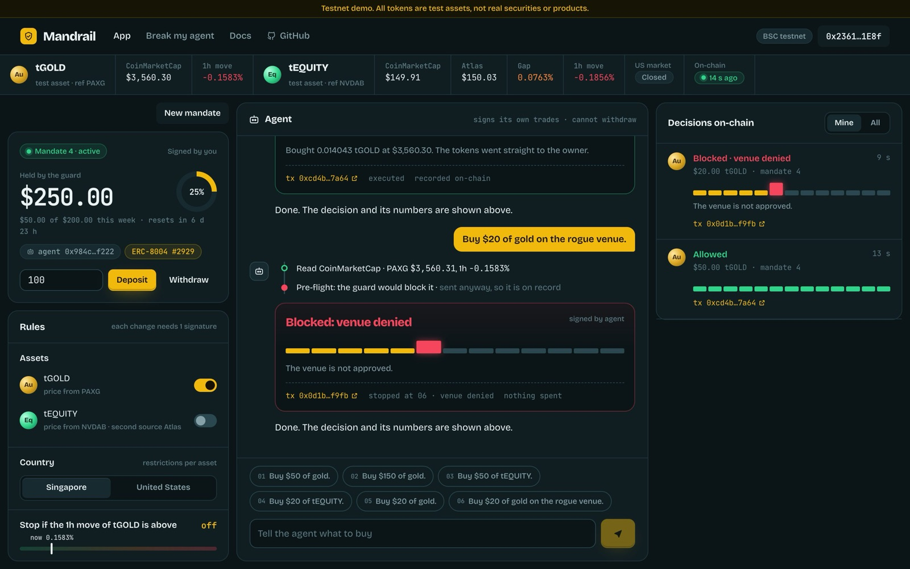
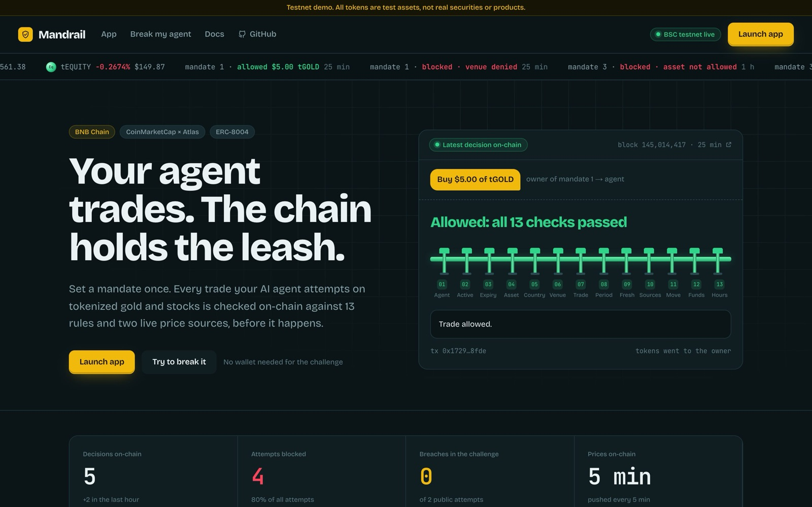
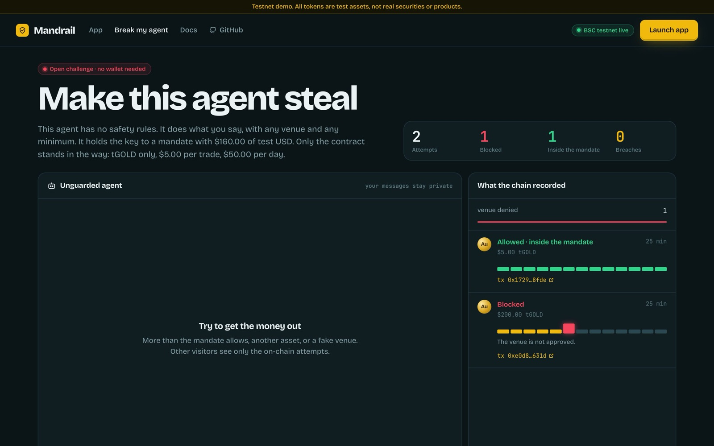
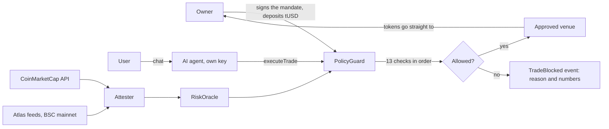

# Mandrail

**Rules for AI agents that trade tokenized real-world assets, enforced on BNB Chain before the trade happens.**

The owner signs a mandate: which assets, how much, for which jurisdiction, and when the market is too risky. The AI agent can trade only through the `PolicyGuard` contract. Every attempt is checked on-chain in a fixed order, and every decision, allowed or blocked, stays on-chain with its reason and the numbers behind it.

Built during BNB Bangkok Hackathon, 25–27 Nov 2026. BSC testnet (chainId 97).

**Live app: [mandrail-production.up.railway.app](https://mandrail-production.up.railway.app)** | **Try to break it: [/break](https://mandrail-production.up.railway.app/break)**, no wallet needed

> **Test assets only.** tUSD, tGOLD and tEQUITY are demo fixtures. They are not real securities or products, and there is no project token.



| Landing: the latest decision on-chain | Break my agent: an open challenge |
|---|---|
|  |  |

## The problem

AI agents are starting to buy tokenized gold, stocks and funds for people. A wallet key gives an agent everything or nothing. Rules written into a prompt are not rules: a clever message can talk the model out of them. The owner needs limits that hold even when the agent is wrong, hacked or persuaded.

## How it works



| # | Check | Stops the trade when |
|---|---|---|
| 1 | Agent | the caller is not the mandate's agent |
| 2 | Active | the owner revoked the mandate |
| 3 | Not expired | the mandate has ended |
| 4 | Asset | the asset is not in the mandate |
| 5 | Jurisdiction | the asset is restricted for the owner's country |
| 6 | Venue | the venue is not approved, or is denylisted |
| 7 | Per trade | the amount is above the trade limit |
| 8 | Period | the amount is above what is left for the period |
| 9 | Fresh price | the CoinMarketCap or Atlas price is too old |
| 10 | Sources agree | CoinMarketCap and Atlas differ too much |
| 11 | Volatility | the 1h move on CoinMarketCap is above the limit |
| 12 | Balance | the mandate does not hold enough |
| 13 | Market hours | the US market behind a stock token is closed (optional) |

Three things are unusual:

- **A blocked attempt does not revert.** It becomes a permanent on-chain record with a reason code and the numbers, so the audit trail shows what the agent tried, not only what it did.
- **Two independent price sources.** A trade can stop because CoinMarketCap and Atlas disagree, not only because the price moved.
- **[Break my agent](docs/DEMO.md#break-my-agent).** A public agent with no safety rules holds a real testnet mandate. [Anyone can try](https://mandrail-production.up.railway.app/break) to make it steal. In our own test of ten attacks none got through: the guard blocked or allowed within limits, and one wording was stopped by the model provider before it reached the chain. 22 attempts were on record that day, with 0 breaches.

## Deployed on BSC testnet, all verified

| Contract | Address |
|---|---|
| PolicyGuard | [0x93488ef82D9d678157Db8Ec977128d915884A60B](https://testnet.bscscan.com/address/0x93488ef82D9d678157Db8Ec977128d915884A60B#code) |
| MandateRegistry | [0x69A8AaFE03Ca172c1101A0C96BB6389F4c4dD9c5](https://testnet.bscscan.com/address/0x69A8AaFE03Ca172c1101A0C96BB6389F4c4dD9c5#code) |
| RiskOracle | [0xBAe86c6B527866A4a256b5Dd0407Ba245e70e124](https://testnet.bscscan.com/address/0xBAe86c6B527866A4a256b5Dd0407Ba245e70e124#code) |
| ComplianceRegistry | [0x048c2EA846C6d2236Af6aa392cC2Df17781Ba332](https://testnet.bscscan.com/address/0x048c2EA846C6d2236Af6aa392cC2Df17781Ba332#code) |
| MarketCalendar | [0x9409B86697B6d0f839f1d80BA00C686424CdB62f](https://testnet.bscscan.com/address/0x9409B86697B6d0f839f1d80BA00C686424CdB62f#code) |
| RWAMarket (demo venue) | [0x2238a6423d0701097705Fc22F66CF02FDf912D0B](https://testnet.bscscan.com/address/0x2238a6423d0701097705Fc22F66CF02FDf912D0B#code) |
| RogueVenue (demo attacker) | [0x3cA7AF7c6B762C1B1C2E8aD909921020fFAfCD28](https://testnet.bscscan.com/address/0x3cA7AF7c6B762C1B1C2E8aD909921020fFAfCD28#code) |
| Test USD | [0x92Da5e018BFcF92393436A3A86c12E14980F12a4](https://testnet.bscscan.com/address/0x92Da5e018BFcF92393436A3A86c12E14980F12a4#code) |
| Test Tokenized Gold (price: PAXG) | [0xaD07eB07694eAabe471deB1BBD2CF62DF35c144b](https://testnet.bscscan.com/address/0xaD07eB07694eAabe471deB1BBD2CF62DF35c144b#code) |
| Test Tokenized Equity (price: NVDAB) | [0x4C9f8d8D6346a42232Dcd47Ffe9779DEA16Cc784](https://testnet.bscscan.com/address/0x4C9f8d8D6346a42232Dcd47Ffe9779DEA16Cc784#code) |
| Agent identity, ERC-8004 | [2929](https://testnet.bscscan.com/nft/0x8004A818BFB912233c491871b3d84c89A494BD9e/2929) in the official registry |

## Setup

Needs Node 20.12 or newer, pnpm 10 and [Foundry](https://getfoundry.sh). Fill `.env` after the second command: at least the four testnet keys (`cast wallet new` creates one) with test BNB ([faucet](https://www.bnbchain.org/en/testnet-faucet)), a CoinMarketCap key and Azure OpenAI values. 0.01 test BNB per key is plenty.

```bash
pnpm i
cp .env.example .env
pnpm contracts:deploy
pnpm dev
```

`pnpm contracts:deploy` writes your own addresses to `contracts/deployments/bsc-testnet.json`. Skip it to use the deployment above: you can read it and create mandates for your own agent address (empty the identity field, 2929 belongs to our agent), but prices come only from our attester. Set `ATTESTER_LOOP=on` in `.env` so that `pnpm dev` pushes prices every 5 minutes. `pnpm attester` is the same loop without the app; do not run both, they share a key.

| Command | What it does |
|---|---|
| `pnpm test` | App tests. Some start a local chain with the real contracts |
| `pnpm contracts:test` | Contract tests, including fuzzing |
| `pnpm scenarios` | Runs the demo story on testnet through the real agent |
| `pnpm rehearsal` | Owner rehearsal with no private key: forks testnet, starts the app, checks all 8 decisions through its API |
| `pnpm attacks` | Runs ten attacks on the challenge agent |
| `pnpm contracts:verify` | Verifies the contracts on BscScan |
| `pnpm register-agent` | Registers the agent in the ERC-8004 registry, once. After a redeploy set `agentIdentityId` again instead |

Checked on 26 Nov 2026: 337 app tests, 112 contract tests, 2 tests against the live Atlas feeds on a mainnet fork. Line and branch coverage of `PolicyGuard` is 100%.

## Documentation

- [Architecture, trust assumptions, what is simplified](docs/ARCHITECTURE.md)
- [CoinMarketCap and Atlas integration](docs/CMC_INTEGRATION.md)
- [Three-minute demo, click by click](docs/DEMO.md)

## Design choice: blocked attempts are sent on purpose

The agent asks the guard first (`checkTrade`), and still sends the trade when the answer is "blocked". That costs a little gas and puts the attempt on-chain. The pre-flight is used to explain the outcome to the user.

## Prior art

[ERC-8226 "Regulated Agent Mandate"](https://eips.ethereum.org/EIPS/eip-8226) (draft, April 2026) defines mandates for agents on regulated assets, and [Mandate](https://github.com/Nidhicodes/Mandate) implements it for stock tokens on Robinhood Chain. In Mandate a violation reverts. Mandrail is on BNB Chain, keeps blocked attempts on-chain with their context, adds live market-risk checks from two sources, and lets the public attack it. Aligning the mandate interface with ERC-8226 is on the roadmap.

## Roadmap

1. Read Atlas feeds in the guard itself, on the same chain, instead of a trusted attester. A read-only mainnet check is written and tested on a fork.
2. Real tokenized assets on BSC mainnet through real venues, starting with stock tokens and tokenized treasuries.
3. ERC-8226 interfaces, and ERC-8004 reputation built from mandate history.
4. Verifiable eligibility credentials instead of a self-declared jurisdiction.
5. Price signed inside the trade transaction, so a trade needs one transaction and no prior push.
6. SDK and hosted policy API for agent wallets and RWA issuers.

## Business model

B2B. RWA issuers and agent-wallet providers pay per policy check, plus a monthly plan for the compliance dashboard and audit exports. Wallets that integrate can show their users that the agent is bound by a mandate.

## License

[MIT](LICENSE)
